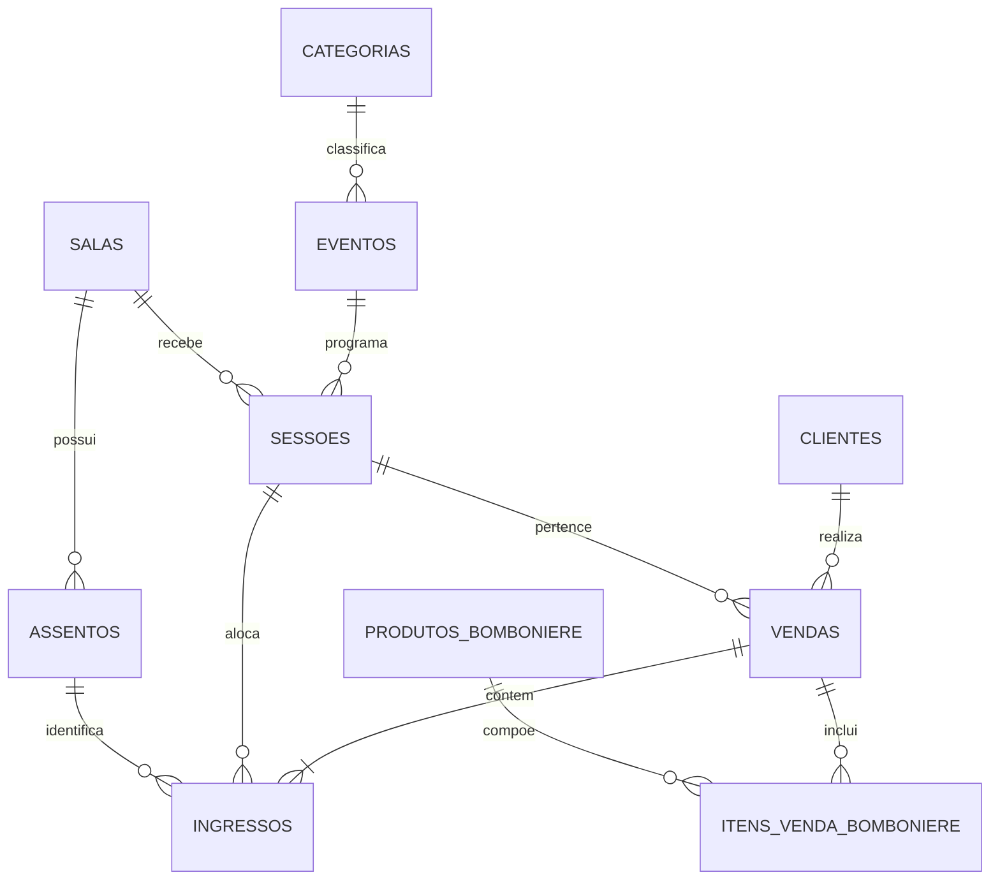

# Diagrama Entidade-Relacionamento

O banco SQLite possui dez tabelas de domínio. Abra [DER.svg](DER.svg) para visualizar ou imprimir o desenho. A definição física completa está em database/schema.sql.

## Dicionário resumido
| Tabela | Chave primária | Chaves estrangeiras | Dados principais |
| --- | --- | --- | --- |
| categorias | id | — | nome e slug únicos, ícone e descrição. |
| eventos | id | categoria_id | título, sinopse, duração, gênero, classificação, imagens, status. |
| salas | id | — | nome único, tipo, capacidade, quantidade de fileiras e assentos. |
| assentos | id | sala_id | fileira, número, código, tipo e ativo; UNIQUE(sala_id,codigo). |
| sessoes | id | evento_id, sala_id | data_hora, formato, idioma, preco_base, ativa. |
| clientes | id | — | nome, CPF, e-mail e telefone; CPF não tem índice UNIQUE no schema atual. |
| vendas | id | cliente_id, sessao_id | localizador único, data, totais, forma_pagamento, status. |
| ingressos | id | venda_id, sessao_id, assento_id | tipo_ingresso, preço; UNIQUE(sessao_id,assento_id). |
| produtos_bomboniere | id | — | nome, categoria, preço, descrição, imagem, disponibilidade. |
| itens_venda_bomboniere | id | venda_id, produto_id | quantidade, preço unitário e subtotal. |

## Integridade e decisões
Uma venda pertence a um cliente e a uma sessão. A aplicação exige ao menos um ingresso por venda; a cardinalidade mínima não é imposta por uma constraint SQL. Uma poltrona pode aparecer em muitos ingressos ao longo do tempo, mas apenas uma vez na mesma sessão.

PRAGMA foreign_keys = ON é ativado em cada conexão. As referências são protegidas por chaves estrangeiras. A validação de assento/sala/sessão e dos tipos é responsabilidade da aplicação; o schema não possui todos os CHECKs de negócio. Não se deve contornar a API e inserir dados arbitrários diretamente no banco.

Os preços e totais são snapshots do pedido, preservados para histórico; são uma desnormalização deliberada. A combinação de UNIQUE e BEGIN IMMEDIATE protege a ocupação concorrente. Índices aceleram buscas por categoria, evento, data, sala e sessão. Não há tabela de pagamento bancário porque não existe integração com gateway.
